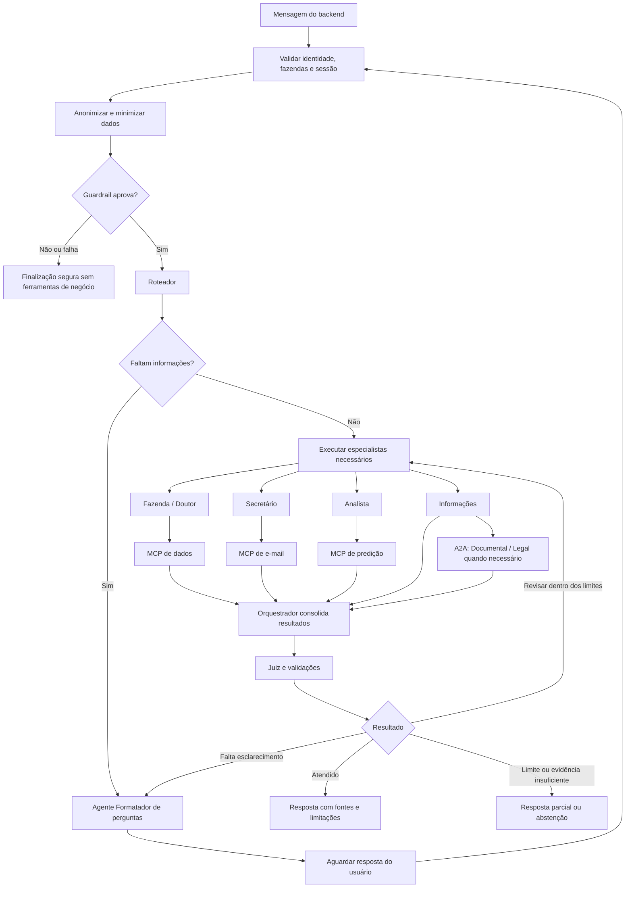

# Argos AI Service

Sistema de IA do Argos, plataforma de gerenciamento de aplicações de
medicamentos em bovinos. O backend chama este serviço em nome do usuário; o
aplicativo Kotlin apresenta respostas e perguntas de esclarecimento.

Este README descreve a **arquitetura planejada**. As pastas e os fluxos abaixo
não representam funcionalidades já implementadas. Backend e mobile ficam em
outros repositórios.

## Agentes

Os agentes são acionados conforme a solicitação; não executam todos a cada
mensagem. O sistema principal usa FastAPI, LangGraph e LangChain.

| Agente                  | Função                                                                                                                                 |
| ----------------------- | -------------------------------------------------------------------------------------------------------------------------------------- |
| Fazenda                 | Consulta aplicações, lotes, bovinos em exceção e carências. Sempre consulta o MCP de dados para responder.                             |
| Doutor                  | Consulta informações documentadas sobre medicamentos no MCP de dados. Apresenta fontes e limites; não substitui avaliação veterinária. |
| Analista                | Solicita cálculos e previsões ao MCP de predição e explica resultados, premissas e limitações.                                         |
| Secretário              | Organiza dados da fazenda e solicita geração e envio de relatórios ao MCP de e-mail.                                                   |
| Informações             | Responde questões gerais e encaminha perguntas documentais ou legais especializadas ao A2A.                                            |
| Orquestrador            | Consolida os resultados, identifica lacunas e solicita complementações dentro dos limites do fluxo.                                    |
| Juiz                    | Verifica se as afirmações têm apoio nas fontes e sinaliza inconsistências ou necessidade de revisão.                                   |
| Formatador de perguntas | Transforma informações faltantes em perguntas de esclarecimento, em texto ou com opções para o aplicativo.                             |
| Documental — A2A        | Consulta termos, condições e FAQs nos PDFs atuais indexados no Qdrant.                                                                 |
| Legal — A2A             | Responde com base nas fontes legais disponíveis, indicando jurisdição, datas e limitações.                                             |

Autenticação, anonimização por regex, validações, cálculos, renderização e envio
não são agentes com LLM. O Roteador seleciona especialistas; o **agente
Formatador de perguntas** produz perguntas em texto ou com opções para o
aplicativo e permite retomar a sessão após a resposta do usuário.

## MCPs

MCP é o protocolo usado para disponibilizar ferramentas aos agentes. Cada MCP é
uma aplicação separada e valida o acesso aos dados solicitados.

| MCP      | Função                                                                                                                                                                                                                                                 |
| -------- | ------------------------------------------------------------------------------------------------------------------------------------------------------------------------------------------------------------------------------------------------------ |
| Dados    | Consulta PostgreSQL e documentos de medicamentos e histórico no MongoDB. Oferece ferramentas de domínio com filtros, paginação e escopo de fazenda; não aceita SQL arbitrário do agente.                                                               |
| E-mail   | Recebe dados estruturados, consulta obrigatoriamente o documento correspondente no MongoDB, preenche um template e envia o relatório a destinatários cadastrados. Registra status e evita envios duplicados; pede esclarecimento quando houver dúvida. |
| Predição | Prepara históricos e executa cálculos ou inferência de modelos. O treinamento ocorre offline. Inicialmente usa dataloads sintéticos, identificando os resultados como simulação; não inventa previsões quando falta modelo ou histórico.               |

## A2A

A2A é o protocolo de comunicação com o serviço dos especialistas Documental e
Legal. O agente Informações do principal encaminha a pergunta e recebe uma
resposta com fontes e limitações.

A cada acionamento, o serviço verifica alterações nos PDFs e atualiza somente os
documentos afetados no Qdrant. Os agentes acessam apenas arquivos atuais e
informam a data do documento e sua última atualização conhecida. PDFs de teste
ficam no repositório.

## Estrutura do projeto

```text
argos-ai-service/
├── apps/
│   ├── main_api/          # API, sessões, grafo e agentes principais
│   ├── mcp_data/          # Consultas aos dados de negócio
│   ├── mcp_email/         # Relatórios e envio de e-mail
│   ├── mcp_prediction/    # Cálculos, inferência e comandos de treino
│   └── a2a_agent/         # Especialistas Documental e Legal, PDFs e Qdrant
├── packages/
│   ├── contracts/        # Modelos Pydantic de comunicação
│   ├── security/         # Validação de identidade e escopo
│   └── observability/    # Logs, traces, métricas e custos
├── tests/                # Contratos, integração, E2E, avaliações e fixtures
├── resources/            # PDFs de teste, templates e manifestos
├── experiments/          # Dataloads e experimentos de predição
├── config/               # Modelos e fallbacks fixos por agente
├── infrastructure/       # Configuração dos serviços locais
├── docs/                 # Planejamento e documentação
├── compose.yaml          # Execução integrada — planejado
└── .github/workflows/    # CI no GitHub Actions
```

Cada aplicação terá Dockerfile, configuração e execução local próprios, além de
deploy independente no futuro. O Compose da raiz executará o conjunto. Pacotes
compartilhados serão instalados dentro de cada imagem.

No principal, a organização separa API, domínio, orquestração, agentes e
infraestrutura. **Protocol + Factory + Registry** padroniza a criação dos
agentes: o Protocol define a interface, o Registry lista os agentes permitidos e
a Factory os instancia com suas dependências.

## Grafo de agentes



Tarefas independentes podem executar em paralelo. O fluxo limita chamadas,
iterações, tempo e custo. A resposta a uma pergunta retoma a sessão após nova
validação de acesso; falhas não são apresentadas como dados ou operações
bem-sucedidas. Ao atingir um limite, o controle determinístico encerra a
execução com conteúdo já validado ou uma mensagem segura.
