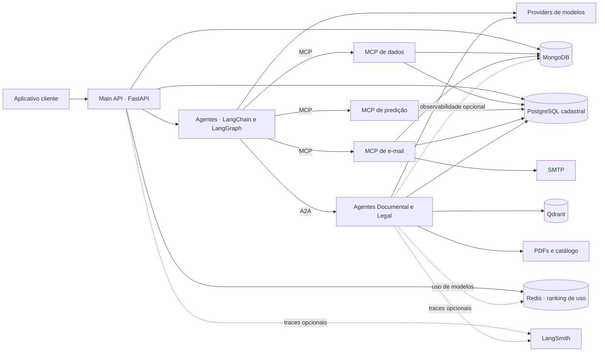

# Argos AI Service

API multiagente do Argos para consultas de pecuária, medicamentos, previsão de
consumo, documentos e relatórios. A Main API usa FastAPI, LangChain e LangGraph;
o backend cadastral e o aplicativo cliente ficam em outros repositórios.

## Componentes

| Componente      | Responsabilidade                                      | Documentação                                                                     |
| --------------- | ----------------------------------------------------- | -------------------------------------------------------------------------------- |
| Main API        | Identidade, sessões, grafo e respostas                | [README](apps/main_api/README.md) · [AGENTS](apps/main_api/AGENTS.md)            |
| MCP de dados    | Consultas autorizadas e origem assinada de relatórios | [README](apps/mcp_data/README.md) · [contrato](apps/mcp_data/MCP.md)             |
| MCP de e-mail   | Preparação, envio idempotente e consulta de estado    | [README](apps/mcp_email/README.md) · [contrato](apps/mcp_email/MCP.md)           |
| MCP de predição | Estimativa determinística baseada no histórico        | [README](apps/mcp_prediction/README.md) · [contrato](apps/mcp_prediction/MCP.md) |
| A2A documental  | Consulta de documentos e leis indexados no Qdrant     | [README](apps/a2a_agent/README.md) · [AGENTS](apps/a2a_agent/AGENTS.md)          |

Os pacotes `contracts`, `security` e `observability` compartilham contratos,
autorização e telemetria. O [índice para agentes](AGENTS.md) aponta os guias
locais e as regras a preservar em cada diretório.

## Arquitetura de alto nível



O [fluxo dos agentes](apps/main_api/docs/agent-workflow.md#visão-do-fluxo)
detalha as decisões e a ordem de execução dentro da Main API.

## Requisitos de Inteligência Artificial

Os links abaixo levam aos arquivos que implementam ou documentam cada demanda no
GitHub. Os modelos e credenciais são configurados por ambiente.

| Demanda                                                       | Onde encontrar                                                                                                                                                                                                 |
| ------------------------------------------------------------- | -------------------------------------------------------------------------------------------------------------------------------------------------------------------------------------------------------------- |
| API FastAPI e escopo do sistema                               | [Aplicação](apps/main_api/app/main.py) · [contrato HTTP](apps/main_api/docs/api-contract.md) · [escopo](#componentes)                                                                                          |
| Sistema multiagente com pelo menos cinco especialistas        | [Registro dos agentes](apps/main_api/app/agents/registry.py) · [escopos e ferramentas](apps/main_api/docs/agent-workflow.md#agentes-e-ferramentas)                                                             |
| LangChain para agentes e modelos                              | [Factory de agentes](apps/main_api/app/infrastructure/agents/langchain_factory.py) · [modelos e fallbacks](apps/main_api/app/infrastructure/agents/model_factory.py)                                           |
| LangGraph para orquestração                                   | [Composição do grafo](apps/main_api/app/graph/workflow.py) · [diagrama do fluxo](apps/main_api/docs/agent-workflow.md#visão-do-fluxo)                                                                          |
| Sessões por usuário e memória de longo prazo                  | [Serviço de sessão](apps/main_api/app/application/session_service.py) · [sessões e memória](apps/main_api/docs/session-memory.md)                                                                              |
| MongoDB em interação conversacional                           | [MongoDB na conversa](infrastructure/mongodb/configuration.md#mongodb-na-conversa) · [collections](infrastructure/mongodb/collections.md)                                                                      |
| Redis para ranking em tempo real                              | [Configuração, contadores e ranking](packages/observability/docs/redis.md) · [código do contador](packages/observability/redis_user_usage.py) · [script de ranking](scripts/observability/rank_usage_24h.py)   |
| MCP e A2A                                                     | [MCP de dados](apps/mcp_data/MCP.md) · [MCP de predição](apps/mcp_prediction/MCP.md) · [MCP de e-mail](apps/mcp_email/MCP.md) · [A2A](apps/a2a_agent/README.md)                                                |
| RAG e fontes externas                                         | [Consultas e recuperação](apps/a2a_agent/src/argos_a2a_agent/application/document_queries.py) · [PDFs e catálogo](apps/a2a_agent/data/documents/catalog.json) · [respostas e fontes](apps/a2a_agent/README.md) |
| Juiz e guardrails                                             | [Fluxo e decisões](apps/main_api/docs/agent-workflow.md) · [nós do grafo](apps/main_api/app/graph/workflow_nodes.py) · [avaliação de risco](apps/main_api/app/infrastructure/agents/input_risk_providers.py)   |
| Latência, erros e custo de modelos                            | [Operação e métricas](packages/observability/docs/operations.md) · [dados para BI](infrastructure/mongodb/analytics-dictionary.md)                                                                             |
| Projeção para 100 e 1.000 usuários, ROI e custo por resolução | [Métodos e dados necessários](packages/observability/docs/operations.md#estimar-custo-e-retorno)                                                                                                               |
| Desenho de arquitetura                                        | [Arquitetura de alto nível](#arquitetura-de-alto-nível)                                                                                                                                                        |

As projeções de custo usam volume e tarifas de cada cenário. O cálculo de ROI
exige dados externos de benefício e custo humano; custo por resolução exige uma
contagem de resoluções. As métricas de observabilidade também estão disponíveis
no dashboard de BI. O Redis precisa estar configurado para fornecer o ranking.

## Fluxo e segurança

O Roteador cria um plano de até cinco tarefas. Os especialistas Fazenda, Doutor,
Analista, Secretário e Informações executam as etapas em ordem de dependência; o
Orquestrador sintetiza os resultados, o Juiz avalia a resposta e os guardrails
protegem entrada e saída. Perguntas de esclarecimento podem interromper e
retomar a interação. Veja o
[fluxo dos agentes](apps/main_api/docs/agent-workflow.md).

A Main API valida identidade e acesso por usuário e propriedade. Sessões,
interações, checkpoints e memória são persistidos no MongoDB; a memória entre
sessões é restrita a preferências permitidas. O envio de e-mail exige origem
assinada e autorização determinística, com idempotência e tratamento de estado
desconhecido. Consulte [sessões e memória](apps/main_api/docs/session-memory.md)
e o [contrato de e-mail](apps/mcp_email/MCP.md).

O LangSmith é opcional e a captura de conteúdo fica desabilitada por padrão.
E-mails não são anonimizados e podem chegar aos modelos, ao histórico e aos
traces quando a captura está habilitada. A coleta Mongo/Redis é de melhor
esforço; veja [observabilidade](packages/observability/docs/operations.md).

## Execução local

Com Python 3.14.3 e Docker, a partir da raiz:

```powershell
python -m pip install -r requirements-dev.txt
python scripts/docker/create-local-env.py
docker compose --profile apps up --build -d
```

O gerador não sobrescreve um `.env` existente sem `--force`. O modo padrão é
`simulated`; para usar provedores reais, configure `ARGOS_MODEL_MODE=provider`,
URLs, modelos e credenciais no `.env`. A API integrada expõe `localhost:8080`;
`/docs` apresenta o Swagger. O modo local de autenticação usa o token stub
`local-dev` conforme o [guia Docker](infrastructure/docker/README.md). No modo
`provider`, configure também o Jev e o fallback Decisions para a avaliação de
risco da entrada; sem decisão válida, a entrada é bloqueada. Os nomes das
variáveis e as regras estão no
[fluxo dos agentes](apps/main_api/docs/agent-workflow.md).

Para executar os testes unitários:

```powershell
python -m pytest tests apps packages -m "not integration"
```

Os READMEs em `apps/<serviço>/tests/integration/` explicam os testes com
infraestrutura descartável. Pré-requisitos, qualidade e locks estão em
[CONTRIBUTING.md](CONTRIBUTING.md).

## Guias de referência

- [API HTTP e exemplos](apps/main_api/docs/api-contract.md) ·
  [OpenAPI](apps/main_api/docs/openapi-main-api.json) ·
  [autenticação](apps/main_api/docs/firebase-authentication.md)
- [MongoDB: configuração](infrastructure/mongodb/configuration.md),
  [collections](infrastructure/mongodb/collections.md) e
  [dicionário de BI](infrastructure/mongodb/analytics-dictionary.md)
- [Redis: ranking e configuração](packages/observability/docs/redis.md)
- [Observabilidade e custos](packages/observability/docs/operations.md) ·
  [extração Mongo](packages/observability/docs/mongodb-extraction.md)
- [Docker local](infrastructure/docker/README.md) ·
  [Kubernetes local](k8s/local/README.md) ·
  [deploy Render](scripts/render/README.md)

A CI verifica qualidade, imagens, testes e cobertura. O deploy Render usa o
código do commit aprovado: `develop` seleciona homologação e `main`, produção.
Cada ambiente exige configuração própria de serviços e secrets.
