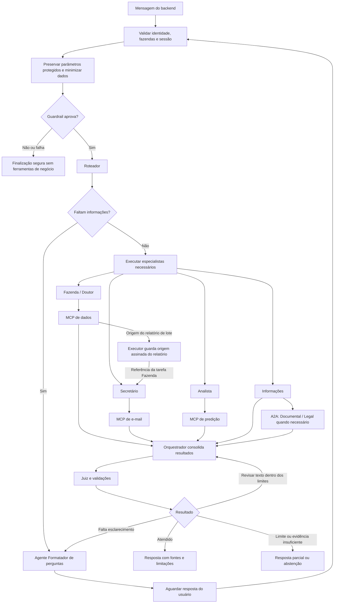

# Argos AI Service

Sistema de IA do Argos, plataforma de gerenciamento de aplicações de
medicamentos em bovinos. O backend chama este serviço em nome do usuário; o
aplicativo Kotlin apresenta respostas e perguntas de esclarecimento.

Este README distingue o código atual das integrações planejadas. Backend e
mobile ficam em outros repositórios.

O principal já tem contratos HTTP, grafo de agentes, Factory e Registry, mas usa
tools simuladas e ainda não conecta autenticação real nem armazenamento de
sessões. O MCP de e-mail já implementa preparação, envio e consulta de estado,
com testes isolados pelo SDK MCP real, Mongo, PostgreSQL e SMTP de teste.
`apps/mcp_data` ainda não tem implementação; seu papel futuro está descrito
abaixo. A integração completa principal → dados → e-mail permanece planejada.

## Agentes

Os agentes são acionados conforme a solicitação; não executam todos a cada
mensagem. O sistema principal usa FastAPI, LangGraph e LangChain.

| Agente                  | Função                                                                                                                                 |
| ----------------------- | -------------------------------------------------------------------------------------------------------------------------------------- |
| Fazenda                 | Consulta aplicações, lotes, bovinos em exceção e carências. Sempre consulta o MCP de dados para responder.                             |
| Doutor                  | Consulta informações documentadas sobre medicamentos no MCP de dados. Apresenta fontes e limites; não substitui avaliação veterinária. |
| Analista                | Solicita cálculos e previsões ao MCP de predição e explica resultados, premissas e limitações.                                         |
| Secretário              | Recebe referências dos dados autorizados de Fazenda pelo executor e solicita preparação, envio e consulta ao MCP de e-mail.            |
| Informações             | Responde questões gerais e encaminha perguntas documentais ou legais especializadas ao A2A.                                            |
| Orquestrador            | Consolida os resultados, identifica lacunas e solicita complementações dentro dos limites do fluxo.                                    |
| Juiz                    | Verifica se as afirmações têm apoio nas fontes e sinaliza inconsistências ou necessidade de revisão.                                   |
| Formatador de perguntas | Transforma informações faltantes em perguntas de esclarecimento, em texto ou com opções para o aplicativo.                             |
| Documental — A2A        | Consulta termos, condições e FAQs nos PDFs atuais indexados no Qdrant.                                                                 |
| Legal — A2A             | Responde com base nas fontes legais disponíveis, indicando jurisdição, datas e limitações.                                             |

Autenticação, anonimização por regex, validações, cálculos, renderização e envio
não são agentes com LLM. O Roteador seleciona especialistas; o **agente
Formatador de perguntas** produz perguntas em texto ou com opções para o
aplicativo e permite retomar a sessão após a resposta do usuário.

## MCPs

MCP é o protocolo usado para disponibilizar ferramentas aos agentes. Cada MCP é
uma aplicação separada e valida o acesso aos dados solicitados.

| MCP                                | Função                                                                                                                                                                                                                                                                                                                         |
| ---------------------------------- | ------------------------------------------------------------------------------------------------------------------------------------------------------------------------------------------------------------------------------------------------------------------------------------------------------------------------------ |
| Dados — planejado                  | Resolve propriedades, rebanhos e lotes autorizados usando a modelagem relacional; consulta documentos de histórico e medicamentos no Mongo. Para relatório, entrega uma projeção de um lote em `LotReportEnvelope`, assinada e vinculada ao solicitante, escopo e validade. Não aceita SQL ou pipelines arbitrários do agente. |
| E-mail — implementado isoladamente | Verifica o envelope recebido, resolve destinatários cadastrados no PostgreSQL, renderiza o relatório e envia pelo no-reply configurado. Guarda preparações e operações no Mongo; não relê o documento Mongo de negócio.                                                                                                        |
| Predição — planejado               | Prepara históricos e executa cálculos ou inferência de modelos. O treinamento ocorre offline. Inicialmente usa dataloads sintéticos, identificando os resultados como simulação; não inventa previsões quando falta modelo ou histórico.                                                                                       |

### Fluxo planejado de relatório de lote

O Roteador cria uma tarefa Fazenda e outra Secretário dependente. Fazenda obtém
`LotReportEnvelope` pelo MCP de dados; o executor preserva o envelope assinado e
passa sua referência ao Secretário. O principal monta as chamadas ao MCP de
e-mail usando os contratos de `packages/contracts`.

O MCP de dados resolve o lote somente nas propriedades autorizadas e obtém sua
projeção Mongo. Código de lote é único por rebanho, e nome de rebanho por
propriedade; correspondências ambíguas exigem esclarecimento. O contrato atual
aceita um lote. O MCP de e-mail resolve nomes/e-mails no cadastro e recebe o
envelope sem consultar novamente o documento de negócio.

O principal preserva os destinatários em contexto protegido antes da sanitização
e valida a intenção antes do envio. Pedido explícito inequívoco pode seguir sem
segunda confirmação; preparar não autoriza enviar.

O MCP de e-mail expõe `prepare_report`, `send_report` e `get_report_status` por
Streamable HTTP em `/mcp`. As tools recebem `payload`; o Bearer interno fica no
transporte. Recuperações reusam o mesmo `report_id` e chave de idempotência.
`accepted` indica aceite pelo provedor, sem comprovar entrega ou leitura.

## A2A

A2A é o protocolo de comunicação com o serviço dos especialistas Documental e
Legal. O agente Informações do principal encaminha a pergunta e recebe uma
resposta com fontes e limitações.

A cada acionamento, o serviço verifica alterações nos PDFs e atualiza somente os
documentos afetados no Qdrant. Os agentes acessam apenas arquivos atuais e
informam a data do documento e sua última atualização conhecida. PDFs de teste
ficam no repositório.

## Estrutura do projeto

```text
argos-ai-service/
├── apps/
│   ├── main_api/          # API, sessões, grafo e agentes principais
│   ├── mcp_data/          # Consultas aos dados de negócio
│   ├── mcp_email/         # Relatórios e envio de e-mail
│   ├── mcp_prediction/    # Cálculos, inferência e comandos de treino
│   └── a2a_agent/         # Especialistas Documental e Legal, PDFs e Qdrant
├── packages/
│   ├── contracts/        # Modelos Pydantic de comunicação
│   ├── security/         # Validação de identidade e escopo
│   └── observability/    # Logs, traces, métricas e custos
├── tests/                # Contratos, integração, E2E, avaliações e fixtures
├── resources/            # PDFs de teste, templates e manifestos
├── experiments/          # Dataloads e experimentos de predição
├── config/               # Modelos e fallbacks fixos por agente
├── infrastructure/       # Configuração dos serviços locais
├── docs/                 # Planejamento e documentação
├── compose.yaml          # Execução integrada — planejado
└── .github/workflows/    # CI no GitHub Actions
```

Cada aplicação terá configuração, dependências e execução próprias, com deploy
independente. Os contratos compartilhados precisam acompanhar o artefato de cada
serviço que os consome; o processo não depende do código de outro serviço
montado em runtime. O Compose integrado da raiz ainda é planejado.

No principal, a organização separa API, domínio, orquestração, agentes e
infraestrutura. **Protocol + Factory + Registry** padroniza a criação dos
agentes: o Protocol define a interface, o Registry lista os agentes permitidos e
a Factory os instancia com suas dependências.

## Grafo de agentes

O desenho abaixo representa o fluxo previsto para as integrações. O executor
atual ordena e executa tarefas sequencialmente; a passagem protegida de
artefatos de relatório ainda será implementada.



Paralelismo de tarefas independentes e limites gerais de tempo/custo são
evoluções planejadas. O grafo atual limita a cinco tarefas e uma revisão do
Juiz. O Juiz revisa a resposta ao chat; a autorização determinística de envio
deve preceder a chamada ao MCP. A resposta a uma pergunta retoma a sessão após
nova validação de acesso; falhas não são apresentadas como dados ou operações
bem-sucedidas. Ao atingir um limite, o controle determinístico encerra a
execução com conteúdo já validado ou uma mensagem segura.
