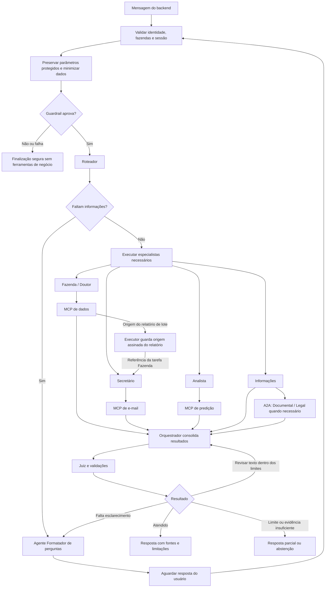

# Argos AI Service

Sistema de IA do Argos, plataforma de gerenciamento de aplicações de
medicamentos em bovinos. O backend chama este serviço em nome do usuário; o
aplicativo Kotlin apresenta respostas e perguntas de esclarecimento.

Este README distingue o código atual das integrações planejadas. Backend e
mobile ficam em outros repositórios.

Para navegar pelos componentes e suas instruções de manutenção, consulte o
[índice de agentes](agent.md). O fluxo de contribuição está em
[CONTRIBUTING.md](CONTRIBUTING.md).

O principal tem contratos HTTP, grafo de agentes, Factory e Registry. Ele usa
Mongo para sessões, mensagens, eventos de execução, checkpoints, resumos e
preferências limitadas do usuário. A API valida o JWT próprio emitido após a
troca do Firebase ID token e carrega do PostgreSQL as fazendas autorizadas em
cada chamada. Ferramentas LangChain vinculam os MCPs configurados com delegação
por usuário, propriedade, agente e operação. A sumarização de sessão e a
extração de memória reutilizam o modelo rápido. O runtime usa dois papéis
configuráveis: rápido (`OPENAI_MODEL_FAST`) para roteador, orquestrador, juiz e
formatador; especialista (`OPENAI_MODEL_SPECIALIST`) para os agentes de domínio.
Ambos usam a API OpenAI e saída estruturada nativa por JSON Schema. Se
`ANTHROPIC_API_KEY` estiver configurada, erros transitórios da OpenAI acionam os
modelos Anthropic de fallback definidos no ambiente para os papéis rápido e
especialista. A Anthropic recebe a entrada daquela chamada. O A2A guarda
embeddings OpenAI e Voyage em vetores Qdrant nomeados e usa Voyage quando a
vetorização OpenAI falha. Sem runtime válido, `/health/ready` retorna
indisponível. Os testes injetam modelos simulados explicitamente por
`create_app(models=...)`.

## Agentes

Os agentes são acionados conforme a solicitação; não executam todos a cada
mensagem. O sistema principal usa FastAPI, LangGraph e LangChain.

| Agente                  | Função                                                                                                                                     |
| ----------------------- | ------------------------------------------------------------------------------------------------------------------------------------------ |
| Fazenda                 | Consulta aplicações, lotes, bovinos em exceção e carências. Sempre consulta o MCP de dados para responder.                                 |
| Doutor                  | Consulta informações documentadas sobre medicamentos no MCP de dados. Apresenta fontes e limites; não substitui avaliação veterinária.     |
| Analista                | Solicita cálculos e previsões ao MCP de predição e explica resultados, premissas e limitações.                                             |
| Secretário              | Recebe referências de Fazenda e pode preparar relatórios ou consultar estado no MCP de e-mail; o envio aguarda autorização determinística. |
| Informações             | Responde questões gerais e encaminha perguntas documentais ou legais especializadas ao A2A.                                                |
| Orquestrador            | Consolida os resultados, identifica lacunas e solicita complementações dentro dos limites do fluxo.                                        |
| Juiz                    | Verifica se as afirmações têm apoio nas fontes e sinaliza inconsistências ou necessidade de revisão.                                       |
| Formatador de perguntas | Transforma informações faltantes em perguntas de esclarecimento, em texto ou com opções para o aplicativo.                                 |
| Documental — A2A        | Consulta termos, condições e FAQs nos PDFs atuais indexados no Qdrant.                                                                     |
| Legal — A2A             | Responde com base nas fontes legais disponíveis, indicando jurisdição, datas e limitações.                                                 |

Autenticação, anonimização por regex, validações, cálculos, renderização e envio
não são agentes com LLM. O Roteador seleciona especialistas; o **agente
Formatador de perguntas** produz perguntas em texto ou com opções para o
aplicativo e permite retomar a sessão após a resposta do usuário.

## MCPs

MCP é o protocolo usado para disponibilizar ferramentas aos agentes. Cada MCP é
uma aplicação separada e valida o acesso aos dados solicitados.

| MCP                         | Função                                                                                                                                                                                                                                                       |
| --------------------------- | ------------------------------------------------------------------------------------------------------------------------------------------------------------------------------------------------------------------------------------------------------------ |
| Dados — implementado        | Expõe consultas de propriedades, rebanhos, lotes, aplicações, exceções, ocorrências, documentos, catálogo e `get_lot_report_source`. A origem `LotReportEnvelope` é filtrada pelo escopo vigente e assinada por Ed25519.                                     |
| E-mail — integração parcial | O Secretário prepara relatórios com a origem assinada, pode solicitar envio após autorização determinística explícita e consulta o estado. A entrega ainda depende de SMTP e chaves internas confiáveis.                                                     |
| Predição — integrado        | Estima consumo de medicamentos por propriedade e unidade, repetindo a média diária mensal de um histórico anual por até 28 dias. A tool Analista envia delegação curta com `prediction.read`; não usa modelo treinado nem prevê produção, doenças ou mortes. |

## Sessões e memória do principal

O MCP de predição só confirma cobertura quando a variável
MCP_PREDICTION_COVERAGE_RELATION aponta para uma view PostgreSQL administrada
pelo pipeline de dados e com as colunas property_id, coverage_start,
coverage_end e evidence_source. As janelas precisam formar uma sequência sem
lacunas. Sem view configurada ou evidência completa, a tool informa cobertura
desconhecida/incompleta e não apresenta estimativa; primeiro e último evento não
são usados como prova.

O contexto enviado aos agentes é limitado a 12.000 caracteres, até 20 mensagens
recentes e uma leitura de no máximo 200 mensagens, mesmo se o sumarizador
falhar. Por interação, o principal limita a 12 chamadas de modelo, 12 chamadas
de ferramenta, 48.000 caracteres totais de saídas de ferramentas, 1.200 tokens
de saída por chamada e 90 segundos de execução. Isso restringe o consumo, mas
não define um teto monetário exato, pois preço e uso reportado variam por
provider e modelo. A telemetria de uso existente permanece de melhor esforço;
não foi criado um ledger durável de custo. Fazenda, Doutor, Analista e
Informações não podem retornar respostas de sucesso sem ao menos uma chamada
externa bem-sucedida; referências geradas pelo modelo são substituídas por
referências opacas das chamadas observadas.

O `main_api` grava sessões e interações no Mongo, sem armazenar as mensagens
originais em paralelo. O conteúdo persistido é sanitizado. A cada 15 entradas
únicas do usuário, o serviço publica um resumo progressivo com teto de 2.000
tokens; o perfil entre sessões é restrito ao tom de comunicação e ao objetivo
geral declarado. Sessões e preferências não expiram automaticamente.

O contexto enviado aos agentes é limitado a 12.000 caracteres, no máximo 20
mensagens recentes e uma leitura de até 200 mensagens para montar a janela;
essas restrições também valem quando o sumarizador está indisponível. Por
interação, o principal limita a 12 chamadas de modelo, 12 chamadas de
ferramenta, 48.000 caracteres totais de respostas de ferramentas, 1.200 tokens
de saída por chamada e 90 segundos de execução. Esses limites restringem
consumo, mas não definem valor monetário exato: preços e uso reportado variam
por provider/modelo. A telemetria de uso existente continua de melhor esforço;
não foi criado um ledger durável de custo.

Respostas de Fazenda, Doutor, Analista e Informações ficam indisponíveis se não
houver chamada externa bem-sucedida. Citações geradas pelo modelo são
substituídas por referências opacas da chamada, sem persistir seu conteúdo.

O tracing LangSmith do `main_api` é opcional e só é ativado quando
`MAIN_API_LANGSMITH_API_KEY` está configurada. Por padrão, traces de agentes,
chamadas a modelos e ferramentas ocultam entradas e saídas; habilite
`MAIN_API_LANGSMITH_CAPTURE_CONTENT=true` somente após aprovar o envio de
prompts, respostas e argumentos de ferramentas ao projeto LangSmith configurado.
E-mails não são anonimizados no código: podem seguir aos modelos e permanecer no
histórico/checkpoint; com captura de conteúdo ativa, também podem ser enviados
ao LangSmith. Essa decisão permite preservar endereços usados pelo fluxo de
destinatários, mas amplia a exposição de PII. Avalie acesso, retenção e política
do provider antes de usar dados pessoais reais. A chave deve ficar no
gerenciador de secrets do ambiente. Para chaves de escopo organizacional,
configure também `MAIN_API_LANGSMITH_WORKSPACE_ID` com o ID do workspace
LangSmith. `MAIN_API_LANGSMITH_AGENT_ID` identifica o Agent e
`MAIN_API_LANGSMITH_AGENT_ENVIRONMENT` seleciona `local`, `development`,
`staging` ou `production`; vazio deriva o valor de `APP_ENV`. Use o mesmo Agent
ID entre ambientes. O workspace precisa ter Agent addressing habilitado.
`MAIN_API_LANGSMITH_ENDPOINT` permite apontar para uma instância aprovada. O
Mongo continua armazenando apenas os eventos brutos sanitizados existentes;
conteúdo de trace é armazenado separadamente pelo LangSmith. A coleta local no
Mongo independe do LangSmith e inclui `X-Argos-Correlation-ID` na resposta,
`correlation_id` nos spans, `parent_observation_id` para relacionar chamadas
aninhadas e `session_id`/`interaction_id` nos spans do grafo. Esses IDs seguem
assinados até as observações A2A para junção direta com as conversas no Mongo. O
correlation ID é enviado às chamadas MCP e segue assinado para Data, Prediction
e A2A; os MCPs não persistem observações próprias no momento. Filas limitadas
podem perder observações, então ausência não significa zero uso. Quando há
contagens de tokens, o custo pode vir do provider ou ser estimado por tarifas
opcionais separadas para `fast`, `specialist`, seus fallbacks, embedding e
fallback de embedding. `billing.cost_source` distingue as origens. Os valores
estimados são persistidos nas observações Mongo e propagados ao LangSmith, mas
são indicativos e não substituem a fatura do provider. Sem contagens ou tarifas
suficientes, custo permanece desconhecido. Operação, ranking de chamadas e
tokens por usuário e limites estão em
[`docs/observability-operations.md`](docs/observability-operations.md); a
extração e o dicionário BI estão em
[`docs/mongodb-observability-extraction.md`](docs/mongodb-observability-extraction.md)
e
[`docs/mongodb-analytics-dictionary.md`](docs/mongodb-analytics-dictionary.md).
Avaliações e feedback podem ser feitos sobre traces na plataforma; esta
integração não define critérios automáticos de qualidade.

As rotas disponíveis incluem `POST /v1/sessions`, `GET /v1/sessions`,
`POST /v1/sessions/{session_id}/interactions/async` e
`GET /v1/sessions/{session_id}/interactions/{operation_id}` para consultar o
processamento assíncrono, além de `GET /v1/sessions/{session_id}/messages`. A
consulta de mensagens não chama o LLM, valida o titular, usa cursor estável e
aceita páginas de 1 a 100 itens (padrão 50). Eventos internos de agentes e tools
não são incluídos no histórico público. O resultado consultado pelo GET de
status contém `created_at`, `status` e `degradation_reasons`; o GET do histórico
também retorna os metadados de degradação disponíveis nas mensagens visíveis do
assistente, para que o aplicativo preserve o aviso de resposta parcial ao
reabrir a conversa.

O contrato OpenAPI e exemplos de autenticação, erros e correlação estão em
[`docs/api-main-api.md`](docs/api-main-api.md) e
[`docs/openapi-main-api.json`](docs/openapi-main-api.json).

O serviço precisa de Mongo em replica set para transações e checkpointer. Os
serviços com persistência própria compartilham o banco `argos_ai` e separam os
dados por collections. A configuração por sistema, variáveis, URIs para host e
Compose, precedência e migração das collections antigas de e-mail estão em
[`docs/mongodb-configuration.md`](docs/mongodb-configuration.md). O Compose
local usa um único `.env` gerado por `scripts/docker/create-local-env.py`; os
`.env.example` de cada aplicação serve para execução individual. Crie o arquivo
local de um serviço copiando o exemplo correspondente, por exemplo
`Copy-Item apps/main_api/.env.example apps/main_api/.env`; esses `.env` locais
são ignorados pelo Git. O Compose individual do A2A carrega seu arquivo. Nas
execuções diretas dos outros serviços, exporte as variáveis para o processo,
pois o Python não lê `.env` automaticamente:
[`apps/main_api/.env.example`](apps/main_api/.env.example),
[`apps/mcp_data/.env.example`](apps/mcp_data/.env.example) e
[`apps/mcp_email/.env.example`](apps/mcp_email/.env.example),
[`apps/mcp_prediction/.env.example`](apps/mcp_prediction/.env.example) e
[`apps/a2a_agent/.env.example`](apps/a2a_agent/.env.example). Em execução local
no host contra o Compose de testes, o URI usa `directConnection=true` porque o
replica set anuncia um nome de host interno. O stub de identidade continua
disponível apenas em ambiente local com `APP_ENV=local` e `AUTH_MODE=stub`. Fora
desse modo, as rotas da API exigem o JWT próprio emitido após a troca do
Firebase ID token em `POST /v1/auth/firebase`. Configure o projeto Firebase, o
acesso somente leitura ao PostgreSQL e a chave Ed25519 própria do `main_api`; as
fazendas são carregadas do cadastro em cada chamada. As decisões para a
integração Firebase, incluindo a associação pelo UID e o tratamento de cadastros
legados, estão em
[`docs/firebase-authentication-identity.md`](docs/firebase-authentication-identity.md).

O tracing LangSmith opcional acompanha uma execução do grafo e suas chamadas
aninhadas a agentes, modelos e ferramentas; os passos de resumo e memória são
registrados separadamente. Sem `MAIN_API_LANGSMITH_API_KEY`, nada é enviado.
Conteúdo fica oculto por padrão; `MAIN_API_LANGSMITH_CAPTURE_CONTENT=true`
habilita prompts, respostas e argumentos de ferramentas após aprovação. E-mails
permanecem sem anonimização; UUIDs, CPFs, CNPJs, telefones e tokens Bearer são
anonimizados antes do envio. O destino usa o Agent ID definido por
`MAIN_API_LANGSMITH_AGENT_ID` e o ambiente derivado de `APP_ENV` ou definido em
`MAIN_API_LANGSMITH_AGENT_ENVIRONMENT`. Use o mesmo Agent ID entre ambientes
para alternar entre Local, Development, Staging e Production. O workspace deve
ter Agent addressing habilitado. O endpoint HTTPS opcional é configurado por
`MAIN_API_LANGSMITH_ENDPOINT`. Para chaves de escopo organizacional, configure
`MAIN_API_LANGSMITH_WORKSPACE_ID`. O serviço A2A possui configuração própria;
IDs assinados de correlação e pai permitem relacionar a observação de chamada do
principal às observações A2A quando ambas as persistências estiverem
habilitadas.

Para executar a mesma suíte unitária da CI em todos os serviços e pacotes, use
`python -m pytest tests apps packages -m "not integration"`. Para executar
apenas um serviço, use `python -m pytest apps/<serviço>/tests/unit`. As
instruções de integração isolada estão nos diretórios de testes da
[Main API](apps/main_api/tests/integration/README.md),
[A2A](apps/a2a_agent/tests/integration/README.md),
[MCP de dados](apps/mcp_data/tests/integration/README.md),
[MCP de e-mail](apps/mcp_email/tests/integration/README.md) e
[MCP de predição](apps/mcp_prediction/tests/integration/README.md). A CI usa os
mesmos arquivos Compose descartáveis e publica relatórios JUnit. O build da
pilha integrada usa os Dockerfiles dos cinco serviços; consulte
[Docker local](docs/docker-local.md) para executar a pilha e builds individuais.

### Fluxo de relatório de lote

O Roteador cria uma tarefa Fazenda e outra Secretário dependente. Fazenda obtém
`LotReportEnvelope` pelo MCP de dados; o executor preserva o envelope assinado e
passa sua referência ao Secretário. O principal monta as chamadas ao MCP de
e-mail usando os contratos de `packages/contracts`.

O MCP de dados resolve o lote somente nas propriedades autorizadas e obtém sua
projeção Mongo. Código de lote é único por rebanho, e nome de rebanho por
propriedade; correspondências ambíguas exigem esclarecimento. O contrato atual
aceita um lote. O MCP de e-mail resolve nomes/e-mails no cadastro e recebe o
envelope sem consultar novamente o documento de negócio.

O principal troca nomes e e-mails de destinatários explícitos por referências
`[DESTINATARIO_n]` antes de persistir a mensagem ou enviá-la ao LLM. O seletor
original e a origem da intenção de envio ficam no checkpoint da interação e
continuam disponíveis durante esclarecimentos; não são reutilizados em outro
pedido. Pedido explícito inequívoco pode seguir sem segunda confirmação;
preparar não autoriza enviar.

O MCP de e-mail expõe `prepare_report`, `send_report` e `get_report_status` por
Streamable HTTP em `/mcp`. As tools recebem `payload`; o Bearer interno fica no
transporte. Recuperações reusam o mesmo `report_id` e chave de idempotência.
`accepted` indica aceite pelo provedor, sem comprovar entrega ou leitura.
`partial` indica que o provedor recusou um ou mais destinatários. A operação não
deve ser reenviada automaticamente, pois outros destinatários podem já ter
recebido o e-mail.

O transporte SMTP usa STARTTLS com validação de cadeia de certificados e nome do
servidor pelo trust store padrão do sistema. `MCP_EMAIL_SMTP_USE_TLS=false` é
reservado a serviços locais de captura, como Mailpit; não use em ambientes com
entrega real. Uma conexão com certificado inválido falha antes do envio.

Se o processo cair depois de reservar uma operação, ela permanece `pending`; se
a conexão cair após o provedor possivelmente aceitar a mensagem, o MCP marca
`unknown`. Repetir a mesma chave de idempotência devolve o estado existente e
nunca chama o SMTP de novo. A operação deve ser reconciliada por uma pessoa
operadora usando o `operation_id`/`provider_message_id` e os registros do
provedor. Não libere nem repita automaticamente uma operação ambígua: só após
confirmar no provedor que nenhum destinatário recebeu a mensagem, uma nova
solicitação explícita pode gerar outra operação. `accepted` significa aceite do
provedor, não entrega ou leitura.

## A2A

A2A é o protocolo de comunicação com o serviço dos especialistas Documental e
Legal. O agente Informações do principal encaminha a pergunta e recebe uma
resposta com fontes e limitações.

A cada acionamento, o serviço verifica alterações nos PDFs e atualiza somente os
documentos afetados no Qdrant. Os agentes acessam apenas arquivos atuais e
informam a data do documento e sua última atualização conhecida. PDFs de teste
ficam no repositório.

O serviço tem build independente em `apps/a2a_agent/Dockerfile` e Compose
individual documentado em
[`apps/a2a_agent/README.md`](apps/a2a_agent/README.md). O runtime implementa
adapters HTTP OpenAI-compatible para embeddings e geração, além de uma consulta
PostgreSQL somente leitura para autorização documental. Endpoints, modelos,
papéis autorizados, credenciais e o Qdrant precisam ser configurados no
deployment. A Main API possui cliente A2A e pode chamá-lo quando configurado; o
serviço usa a origem local de documentos implementada neste repositório.

## Estrutura do projeto

```text
argos-ai-service/
├── apps/
│   ├── main_api/          # API, sessões, grafo e agentes principais
│   ├── mcp_data/          # Consultas aos dados de negócio
│   ├── mcp_email/         # Relatórios e envio de e-mail
│   ├── mcp_prediction/    # Estimativa determinística de consumo
│   └── a2a_agent/         # Serviço isolado: especialistas, PDFs, Qdrant e imagem
├── packages/
│   ├── contracts/        # Modelos Pydantic de comunicação
│   ├── security/         # Validação de identidade e escopo
│   └── observability/    # Logs, traces, métricas e custos
├── tests/                # Testes transversais de deploy Render
├── infrastructure/       # PostgreSQL e fixtures locais
├── k8s/                  # Recursos Kubernetes locais
├── scripts/              # Scripts de operação local e deploy
├── docs/                 # Contratos, operação e registros de planejamento
├── compose.yaml          # Dependências locais e perfil integrado de serviços
└── .github/workflows/    # CI no GitHub Actions
```

Cada aplicação tem configuração, dependências e execução próprias, com deploy
independente. Os contratos compartilhados precisam acompanhar o artefato de cada
serviço que os consome; o processo não depende do código de outro serviço
montado em runtime. O perfil Docker integrado, o schema e os dados sintéticos
PostgreSQL, e os providers de modelo simulados estão documentados em
[`docs/docker-local.md`](docs/docker-local.md). O modo simulado permite
exercitar o fluxo sem chaves externas e identifica suas respostas como
ilustrativas.

No principal, a organização separa API, domínio, orquestração, agentes e
infraestrutura. **Protocol + Factory + Registry** padroniza a criação dos
agentes: o Protocol define a interface, o Registry lista os agentes permitidos e
a Factory os instancia com suas dependências.

## Grafo de agentes

O desenho abaixo resume o fluxo implementado. O executor ordena e executa
tarefas sequencialmente e preserva referências aos artefatos assinados de
relatório para as tarefas dependentes.



O executor não paraleliza tarefas independentes. O grafo atual limita a cinco
tarefas e uma revisão do Juiz. O Juiz revisa a resposta ao chat; a autorização
determinística de envio deve preceder a chamada ao MCP. A resposta a uma
pergunta retoma a sessão após nova validação de acesso; falhas não são
apresentadas como dados ou operações bem-sucedidas. Ao atingir um limite, o
controle determinístico encerra a execução com conteúdo já validado ou uma
mensagem segura.

Para subir a integração em um cluster Kubernetes local, consulte
[docs/kubernetes-local.md](docs/kubernetes-local.md). O estado e os resultados
de homologação integrada estão em
[docs/local-validation-results.md](docs/local-validation-results.md).

O deploy pelo código-fonte no Render está preparado em
[docs/deploy-render.md](docs/deploy-render.md): `develop` atualiza HM e `main`
atualiza produção após a CI, com cinco serviços independentes por ambiente e
reimplantação dos consumidores quando `packages/` muda. A ativação depende da
configuração inicial dos serviços e secrets descrita no guia.
