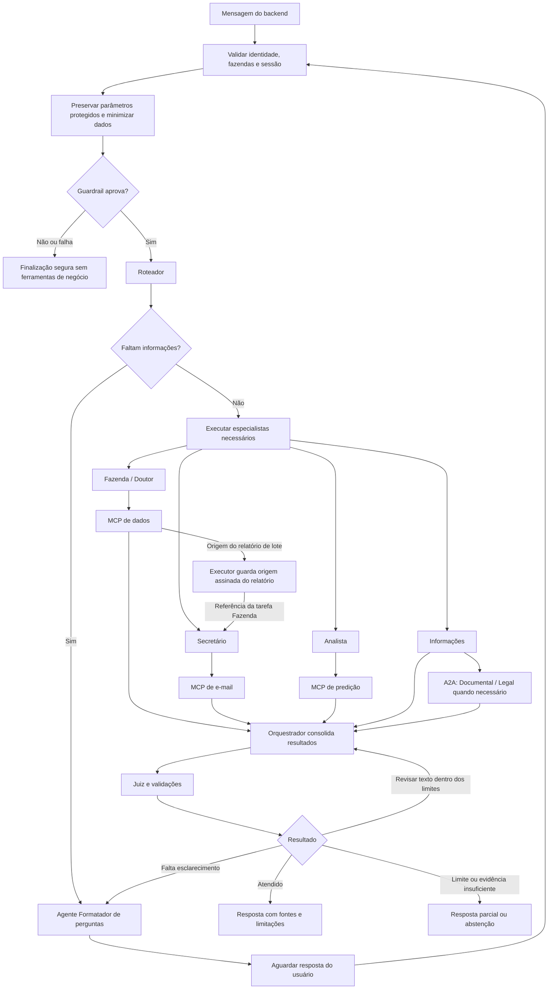

# Argos AI Service

Sistema de IA do Argos, plataforma de gerenciamento de aplicações de
medicamentos em bovinos. O backend chama este serviço em nome do usuário; o
aplicativo Kotlin apresenta respostas e perguntas de esclarecimento.

Este README distingue o código atual das integrações planejadas. Backend e
mobile ficam em outros repositórios.

O principal tem contratos HTTP, grafo de agentes, Factory e Registry. Ele usa
Mongo para sessões, mensagens, eventos de execução, checkpoints, resumos e
preferências limitadas do usuário. A API valida identidade JWT EdDSA do backend
e vincula ferramentas LangChain aos MCPs configurados, com delegação por
usuário, propriedade, agente e operação. O backend ainda não inclui `farm_ids`,
então a criação de sessão permanece bloqueada até delegar o escopo autorizado. O
MCP de dados oferece consultas somente leitura; a projeção assinada para
relatórios e o fluxo completo principal → dados → e-mail ainda não estão
implementados. O MCP de e-mail permite preparar relatórios e consultar estado
pelo Secretário; o envio não está exposto ao LLM.

## Agentes

Os agentes são acionados conforme a solicitação; não executam todos a cada
mensagem. O sistema principal usa FastAPI, LangGraph e LangChain.

| Agente                  | Função                                                                                                                                     |
| ----------------------- | ------------------------------------------------------------------------------------------------------------------------------------------ |
| Fazenda                 | Consulta aplicações, lotes, bovinos em exceção e carências. Sempre consulta o MCP de dados para responder.                                 |
| Doutor                  | Consulta informações documentadas sobre medicamentos no MCP de dados. Apresenta fontes e limites; não substitui avaliação veterinária.     |
| Analista                | Solicita cálculos e previsões ao MCP de predição e explica resultados, premissas e limitações.                                             |
| Secretário              | Recebe referências de Fazenda e pode preparar relatórios ou consultar estado no MCP de e-mail; o envio aguarda autorização determinística. |
| Informações             | Responde questões gerais e encaminha perguntas documentais ou legais especializadas ao A2A.                                                |
| Orquestrador            | Consolida os resultados, identifica lacunas e solicita complementações dentro dos limites do fluxo.                                        |
| Juiz                    | Verifica se as afirmações têm apoio nas fontes e sinaliza inconsistências ou necessidade de revisão.                                       |
| Formatador de perguntas | Transforma informações faltantes em perguntas de esclarecimento, em texto ou com opções para o aplicativo.                                 |
| Documental — A2A        | Consulta termos, condições e FAQs nos PDFs atuais indexados no Qdrant.                                                                     |
| Legal — A2A             | Responde com base nas fontes legais disponíveis, indicando jurisdição, datas e limitações.                                                 |

Autenticação, anonimização por regex, validações, cálculos, renderização e envio
não são agentes com LLM. O Roteador seleciona especialistas; o **agente
Formatador de perguntas** produz perguntas em texto ou com opções para o
aplicativo e permite retomar a sessão após a resposta do usuário.

## MCPs

MCP é o protocolo usado para disponibilizar ferramentas aos agentes. Cada MCP é
uma aplicação separada e valida o acesso aos dados solicitados.

| MCP                         | Função                                                                                                                                                                                                                                                       |
| --------------------------- | ------------------------------------------------------------------------------------------------------------------------------------------------------------------------------------------------------------------------------------------------------------ |
| Dados — implementado        | Expõe consultas de propriedades, rebanhos, lotes, aplicações, exceções, ocorrências, documentos e catálogo de medicamentos. As tools Fazenda e Doutor usam delegações curtas por chamada. A projeção assinada `LotReportEnvelope` segue pendente.            |
| E-mail — integração parcial | O Secretário pode preparar relatórios e consultar estado com identidade do usuário vinculada pelo principal. `send_report` permanece fora do conjunto de tools do LLM até haver autorização determinística de envio.                                         |
| Predição — integrado        | Estima consumo de medicamentos por propriedade e unidade, repetindo a média diária mensal de um histórico anual por até 28 dias. A tool Analista envia delegação curta com `prediction.read`; não usa modelo treinado nem prevê produção, doenças ou mortes. |

## Sessões e memória do principal

O `main_api` grava sessões e interações no Mongo, sem armazenar as mensagens
originais em paralelo. O conteúdo persistido é sanitizado. A cada 15 entradas
únicas do usuário, o serviço publica um resumo progressivo com teto de 2.000
tokens; o perfil entre sessões é restrito ao tom de comunicação e ao objetivo
geral declarado. Sessões e preferências não expiram automaticamente.

O tracing LangSmith do `main_api` é opcional e só é ativado quando
`MAIN_API_LANGSMITH_API_KEY` está configurada. Por padrão, traces de agentes,
chamadas a modelos e ferramentas ocultam entradas e saídas; habilite
`MAIN_API_LANGSMITH_CAPTURE_CONTENT=true` somente após aprovar o envio de
prompts, respostas e argumentos de ferramentas ao projeto LangSmith configurado.
A chave deve ficar no gerenciador de secrets do ambiente.
`MAIN_API_LANGSMITH_PROJECT` seleciona o projeto e `MAIN_API_LANGSMITH_ENDPOINT`
permite apontar para uma instância aprovada. O Mongo continua armazenando apenas
os eventos brutos sanitizados existentes; conteúdo de trace é armazenado
separadamente pelo LangSmith. Avaliações e feedback podem ser feitos sobre os
traces na plataforma; esta integração não define critérios automáticos de
qualidade.

As rotas disponíveis são `POST /v1/sessions`, `GET /v1/sessions`,
`POST /v1/sessions/{session_id}/interactions` e
`GET /v1/sessions/{session_id}/messages`. A consulta de mensagens não chama o
LLM, valida o titular, usa cursor estável e aceita páginas de 1 a 100 itens
(padrão 50). Eventos internos de agentes e tools não são incluídos no histórico
público.

O serviço precisa de Mongo em replica set para transações e checkpointer. As
configurações principais são `MAIN_API_MONGO_URI` e `MAIN_API_MONGO_DATABASE`;
veja [`apps/main_api/.env.example`](apps/main_api/.env.example). Em testes
locais executados no host contra o Compose, use o URI de conexão direta
documentado no README dos testes de integração. O stub de identidade continua
disponível apenas em ambiente local com `APP_ENV=local` e `AUTH_MODE=stub`. Fora
desse modo, configure a chave pública Ed25519 do backend em
`MAIN_API_AUTH_TRUSTED_PUBLIC_KEYS`; a API valida issuer, audience, validade,
agente e operações delegadas. O backend deve incluir `farm_ids` no token para
que a API possa abrir sessões com o escopo autorizado.

O tracing LangSmith opcional acompanha uma execução do grafo e suas chamadas
aninhadas a agentes, modelos e ferramentas; os passos de resumo e memória são
registrados separadamente. Sem `MAIN_API_LANGSMITH_API_KEY`, nada é enviado.
Conteúdo fica oculto por padrão; `MAIN_API_LANGSMITH_CAPTURE_CONTENT=true`
habilita prompts, respostas e argumentos de ferramentas após aprovação. Com a
captura ativa, e-mails, UUIDs, CPFs e tokens Bearer são anonimizados. O projeto
é selecionado por `MAIN_API_LANGSMITH_PROJECT` e o endpoint HTTPS opcional por
`MAIN_API_LANGSMITH_ENDPOINT`. O serviço A2A possui configuração própria; os
traces dos dois processos não recebem um vínculo distribuído entre serviços.

Testes unitários: `python -m pytest apps/main_api/tests/unit -q`. Testes de
persistência e retomada com Mongo replica set descartável: siga
[`apps/main_api/tests/integration/README.md`](apps/main_api/tests/integration/README.md).
O job `Main API Mongo integration tests` da CI executa esses testes e publica o
relatório JUnit.

### Fluxo planejado de relatório de lote

O Roteador cria uma tarefa Fazenda e outra Secretário dependente. Fazenda obtém
`LotReportEnvelope` pelo MCP de dados; o executor preserva o envelope assinado e
passa sua referência ao Secretário. O principal monta as chamadas ao MCP de
e-mail usando os contratos de `packages/contracts`.

O MCP de dados resolve o lote somente nas propriedades autorizadas e obtém sua
projeção Mongo. Código de lote é único por rebanho, e nome de rebanho por
propriedade; correspondências ambíguas exigem esclarecimento. O contrato atual
aceita um lote. O MCP de e-mail resolve nomes/e-mails no cadastro e recebe o
envelope sem consultar novamente o documento de negócio.

O principal troca nomes e e-mails de destinatários explícitos por referências
`[DESTINATARIO_n]` antes de persistir a mensagem ou enviá-la ao LLM. O seletor
original e a origem da intenção de envio ficam no checkpoint da interação e
continuam disponíveis durante esclarecimentos; não são reutilizados em outro
pedido. Pedido explícito inequívoco pode seguir sem segunda confirmação;
preparar não autoriza enviar.

O MCP de e-mail expõe `prepare_report`, `send_report` e `get_report_status` por
Streamable HTTP em `/mcp`. As tools recebem `payload`; o Bearer interno fica no
transporte. Recuperações reusam o mesmo `report_id` e chave de idempotência.
`accepted` indica aceite pelo provedor, sem comprovar entrega ou leitura.
`partial` indica que o provedor recusou um ou mais destinatários. A operação não
deve ser reenviada automaticamente, pois outros destinatários podem já ter
recebido o e-mail.

## A2A

A2A é o protocolo de comunicação com o serviço dos especialistas Documental e
Legal. O agente Informações do principal encaminha a pergunta e recebe uma
resposta com fontes e limitações.

A cada acionamento, o serviço verifica alterações nos PDFs e atualiza somente os
documentos afetados no Qdrant. Os agentes acessam apenas arquivos atuais e
informam a data do documento e sua última atualização conhecida. PDFs de teste
ficam no repositório.

O serviço tem build independente em `apps/a2a_agent/Dockerfile` e Compose
operacional documentado em
[`apps/a2a_agent/README.md`](apps/a2a_agent/README.md). O runtime implementa
adapters HTTP OpenAI-compatible para embeddings e geração, além de uma consulta
PostgreSQL somente leitura para autorização documental. Endpoints, modelos,
papéis autorizados, credenciais e o Qdrant precisam ser configurados no
deployment. A origem cloud e a chamada real pelo principal seguem pendentes.

## Estrutura do projeto

```text
argos-ai-service/
├── apps/
│   ├── main_api/          # API, sessões, grafo e agentes principais
│   ├── mcp_data/          # Consultas aos dados de negócio
│   ├── mcp_email/         # Relatórios e envio de e-mail
│   ├── mcp_prediction/    # Cálculos, inferência e comandos de treino
│   └── a2a_agent/         # Serviço isolado: especialistas, PDFs, Qdrant e imagem
├── packages/
│   ├── contracts/        # Modelos Pydantic de comunicação
│   ├── security/         # Validação de identidade e escopo
│   └── observability/    # Logs, traces, métricas e custos
├── tests/                # Contratos, integração, E2E, avaliações e fixtures
├── resources/            # PDFs de teste, templates e manifestos
├── experiments/          # Dataloads e experimentos de predição
├── config/               # Modelos e fallbacks fixos por agente
├── infrastructure/       # Configuração dos serviços locais
├── docs/                 # Planejamento e documentação
├── compose.yaml          # Execução integrada — planejado
└── .github/workflows/    # CI no GitHub Actions
```

Cada aplicação terá configuração, dependências e execução próprias, com deploy
independente. Os contratos compartilhados precisam acompanhar o artefato de cada
serviço que os consome; o processo não depende do código de outro serviço
montado em runtime. O Compose integrado da raiz ainda é planejado.

No principal, a organização separa API, domínio, orquestração, agentes e
infraestrutura. **Protocol + Factory + Registry** padroniza a criação dos
agentes: o Protocol define a interface, o Registry lista os agentes permitidos e
a Factory os instancia com suas dependências.

## Grafo de agentes

O desenho abaixo representa o fluxo previsto para as integrações. O executor
atual ordena e executa tarefas sequencialmente; a passagem protegida de
artefatos de relatório ainda será implementada.



Paralelismo de tarefas independentes e limites gerais de tempo/custo são
evoluções planejadas. O grafo atual limita a cinco tarefas e uma revisão do
Juiz. O Juiz revisa a resposta ao chat; a autorização determinística de envio
deve preceder a chamada ao MCP. A resposta a uma pergunta retoma a sessão após
nova validação de acesso; falhas não são apresentadas como dados ou operações
bem-sucedidas. Ao atingir um limite, o controle determinístico encerra a
execução com conteúdo já validado ou uma mensagem segura.
