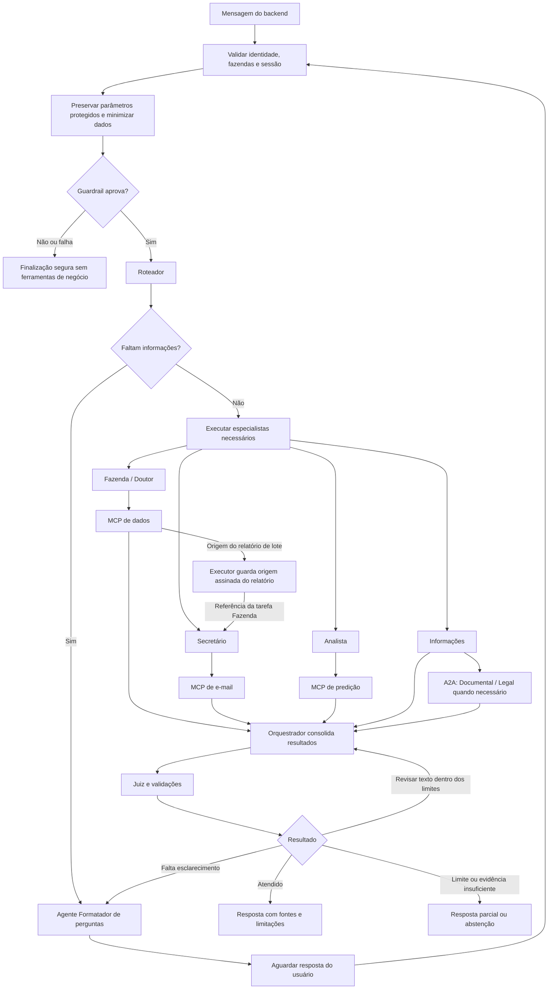

# Fluxo dos agentes e integrações

Este guia descreve o grafo atual da Main API. Para execução e contrato HTTP,
consulte [README da Main API](../README.md); para detalhes de sessão e memória,
veja [persistência](session-memory.md).

## Orquestração

`apps/main_api/app/graph/workflow.py` compõe o grafo LangGraph. Após o guardrail
de entrada, o roteador pode solicitar esclarecimento ou produzir um plano com
até cinco tarefas. O executor ordena as dependências e executa os especialistas
sequencialmente. Depois, o Orquestrador redige a resposta com os resultados; o
Juiz pode aprovar, solicitar uma revisão dentro do limite ou encaminhar para
resposta segura. Perguntas passam pelo formatador e guardrail de pergunta;
respostas aprovadas passam pelo guardrail de saída. O limite atual de revisão é
um; o Juiz não executa ferramentas por conta própria.

Uma tarefa dependente recebe o resultado das dependências indicadas no plano. No
fluxo de relatório, o executor preserva uma referência ao envelope de origem
assinado, validada antes de seu uso pelo Secretário. Respostas de pergunta são
validadas contra sessão, identidade, expiração e estado antes da retomada.

## Agentes e ferramentas

O Registry define schemas, política de modelo e slots permitidos; a Factory
LangChain os instancia. O runtime injeta os clientes configurados e somente usa
mocks quando explicitamente solicitado em testes.

| Agente        | Slot                 | Serviço                |
| ------------- | -------------------- | ---------------------- |
| `farm`        | `farm_data`          | MCP de dados           |
| `doctor`      | `medicine_reference` | MCP de dados           |
| `analyst`     | `prediction`         | MCP de predição        |
| `secretary`   | `report_delivery`    | MCP de e-mail          |
| `information` | `documental_a2a`     | A2A documental e legal |

Roteador, Orquestrador, Juiz e formatador de perguntas não têm slots de
ferramentas no Registry. O modelo não escolhe a identidade, o escopo nem as
credenciais das chamadas; os serviços validam sua própria autorização.

## Modelos e retomada

As políticas `FAST` e `SPECIALIST` configuram os modelos; o wrapper combina o
principal e o fallback Anthropic configurado para falhas elegíveis, inclusive
saída estruturada e tools. Contagem de tokens é usada na sumarização. Consulte
`app/infrastructure/agents/model_factory.py` para exceções e configuração.

`execute_workflow` inicia e `resume_workflow_answer` retoma o grafo. Ambos usam
`session_id` como `thread_id`; o checkpointer da raiz usa namespace vazio.
`called_agents`, fontes, erros e `retry_count` são estado do grafo;
`retry_count` acompanha revisões, não todas as tentativas de provider. Para
traces, latência, uso e custos, veja
[observabilidade](../../../packages/observability/docs/operations.md).

## Visão do fluxo

O contexto inclui até 12.000 caracteres, 20 mensagens recentes e leitura de até
200 mensagens. Os limites de chamadas, tempo e saída são definidos na
configuração de execução; consulte `app/application/execution_limits.py` e
`app/session_config.py`.
