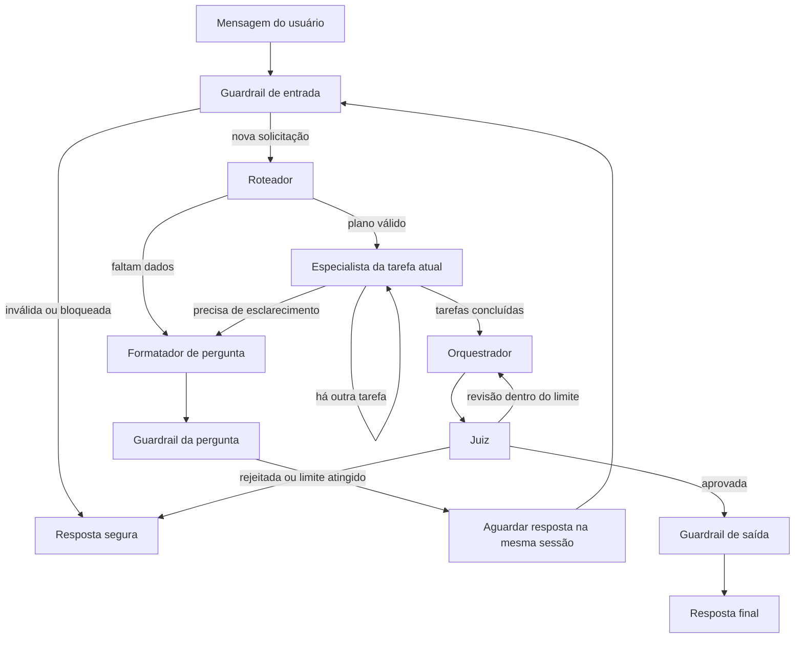

# Handoff dos agentes: Bia → Fazan

Este guia registra o que o grafo já entrega e os pontos que recebem as
integrações externas. O objetivo é manter os nós e os prompts independentes dos
clientes MCP, do serviço A2A, dos modelos e da persistência de sessões.

## Fluxo implementado



O grafo está em `apps/main_api/app/graph/workflow.py`. O estado compartilhado,
os schemas Pydantic e os prompts tipam o plano, os resultados intermediários, as
fontes e as decisões do Juiz. Os testes do grafo usam agentes falsos; não
precisam de modelos, bancos ou servidores MCP reais.

## Slots de ferramentas

O Registry autoriza grupos de ferramentas por agente. O Factory mantém um
`create_agent` explícito para cada agente e recebe implementações por
`tool_bindings`. Os mocks são o padrão; uma integração pode substituir só os
grupos que já estiverem prontos.

| Agente        | Slot permitido                 | Responsabilidade da implementação conectada         |
| ------------- | ------------------------------ | --------------------------------------------------- |
| `farm`        | `farm_data`                    | Consultas de dados da fazenda autorizada            |
| `doctor`      | `medicine_reference`           | Busca de informação documentada sobre medicamentos  |
| `analyst`     | `prediction`                   | Cálculos e previsões com premissas identificáveis   |
| `secretary`   | `farm_data`, `report_delivery` | Consulta de dados e preparação/entrega de relatório |
| `information` | `documental_a2a`               | Consulta ao serviço Documental por A2A              |

`legal` não é uma rota especialista direta no grafo atual. Pedidos que exigem
interpretação jurídica não devem virar aconselhamento do agente `information`.

O Fazan pode carregar as tools LangChain dos clientes MCP/A2A e passá-las ao
Factory pelos slots. Cada slot aceita uma sequência de tools; a identidade real
da tool pode ser diferente do nome do mock. O Registry continua impedindo que um
grupo seja atribuído a um agente não autorizado.

Exemplo de composição quando os adaptadores estiverem disponíveis:

```python
factory = build_agent_factory(
    models,
    tool_bindings={
        AgentId.FARM: {"farm_data": farm_tools},
        AgentId.DOCTOR: {"medicine_reference": medicine_tools},
        AgentId.ANALYST: {"prediction": prediction_tools},
        AgentId.SECRETARY: {
            "farm_data": farm_tools,
            "report_delivery": report_tools,
        },
        AgentId.INFORMATION: {"documental_a2a": documental_tools},
    },
)
graph = build_graph(factory, checkpointer=checkpointer)
```

`models` é o mapa de políticas de modelo do Registry. A configuração real dos
modelos e os clientes/conexões continuam sendo fornecidos pela camada de
infraestrutura. O exemplo não inicializa servidor nem credenciais.

## FastAPI, sessão e retomada

Depois de validar usuário, fazenda e sessão, o serviço da API pode chamar
`executar_fluxo` para uma nova mensagem ou `executar_resposta` para responder a
uma pergunta pendente. As duas funções aceitam `RunnableConfig`, preservam
callbacks, tags e metadados e sempre definem o `thread_id` a partir do
`session_id` validado. Para retomar uma pergunta, o grafo precisa ser compilado
com um checkpointer compartilhado entre as chamadas.

Os identificadores de usuário, fazenda e sessão vêm do contexto autenticado da
API e são encaminhados aos agentes para uso pelas tools. O modelo não deve
escolher nem substituir esses identificadores.

## Observabilidade e contagem de chamadas

O estado do grafo já registra `called_agents`, `sources`, `errors` e
`retry_count`. `retry_count` conta revisões solicitadas pelo Juiz; não conta
tentativas internas do provedor. O `RunnableConfig` permite ao serviço conectar
callbacks de tracing sem acoplar o fluxo a um backend específico.

Contagem lógica de agentes por execução:

- Fluxo completo sem revisão: 1 roteador + N especialistas + 1 orquestrador + 1
  juiz = 3 + N; o plano limita N a 5.
- Uma revisão do Juiz acrescenta 1 orquestrador e 1 juiz; o máximo desse fluxo é
  10 invocações lógicas de agentes.
- Se o roteador identificar campos faltantes, são 1 roteador + 1 formatador de
  perguntas antes da pausa. Uma retomada é outra chamada do grafo na mesma
  sessão.

Esses números contam invocações lógicas de agentes, não chamadas reais ao
provedor nem chamadas individuais de tools. Um agente pode chamar o modelo mais
de uma vez durante o uso de tools; tracing de modelo, tokens, latência, custo,
SLO e painel pertencem à observabilidade de serviço. A Etapa 6 ensina esses
conceitos, mas seus preços, nomes de modelos, módulo de monitoramento e tela são
específicos do projeto do professor e não foram copiados para o Argos.

## Limites entre as entregas

Do lado dos agentes ficam o fluxo, prompts, schemas, regras de roteamento,
guardrails, retomada, mocks, testes e estes contratos de integração. Os modelos
reais, serviços MCP/A2A, persistência de sessão/checkpoint e a infraestrutura de
observabilidade são conectados quando os serviços do Fazan estiverem
disponíveis. Os testes unitários continuam executáveis com os mocks enquanto
isso não acontece.
